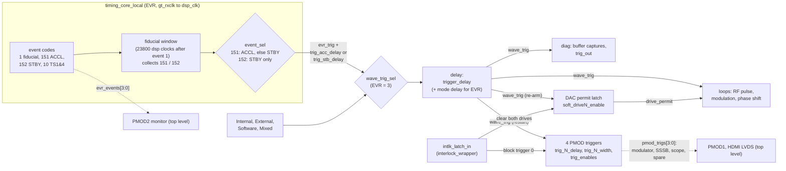
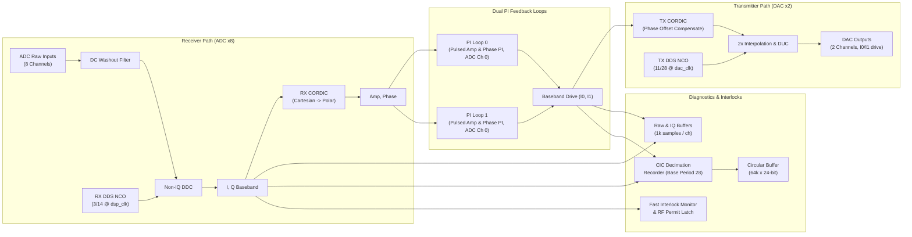

# LEMP Facility DSP Configuration

This directory contains the DSP configuration and static register mapping for the **SLAC LEMP (Linac Electronics Modernization Project)** application.

## Design Architecture & Shell Flavor

- **Frequency Configuration (`FSET`)**: `LEMP`
- **`llrf_shell` Flavor**: **LEMP** (`llrf_shell.sv`, plan step 9c): the base shell's blocks (ADC 6 and 7, beam voltage and current, as DC channels on the monitor path) plus the LEMP features of the LEMP branch (2e25cd9):
  - one master trigger, as in the other designs (plan D27): `wave_trig_sel` alone selects the source of `wave_trig`. EVR (3), the LEMP operating mode, selects the EVR trigger of `timing_core_local.v`: after each fiducial (event 1) it fires once if accelerate (151) or standby (152) came within the window (`event_sel` 151: accelerate, else standby; 152: standby only), and `wave_trig` follows it by that mode's delay (`trig_acc_delay`, `trig_stb_delay`); `trigger_delay` delays every source;
  - four PMOD triggers (`triggers.sv`, `trig_N_width`/`trig_N_delay` as `cfg_dsp.trig[N]`, `trig_enables`), restarted by `wave_trig` and firing `trig_N_delay` after it; an interlock latch stops trigger 0 (modulator);
  - per-loop phase shift `loopN_phs_shift` from `loopN_phs_shift_delay` dsp clocks into the pulse to its end, at clock resolution whatever `pulse_res_shift` is (D28);
  - the DAC permit latch: any latched interlock (`intlk_latch_in`) turns both drives off; `wave_trig` re-arms them from `soft_driveN_enable`;
  - SSSB control (`sssb_rf_switch`, `sssb_rst`, inverted outputs; `sssb_alarm`, `sssb_rf_status` status);
  - `timing_core_local.v` (event codes 151, 152, 1, 10 to `evr_events`, their rates as `evr_frequency_event1..4`; the EVR trigger from `fiducial_int_gen.v`; rates counted on `dsp_clk`, gated by the events).
- **Register map**: the base map in `uspas_llrf/regmap.py` with `design.py`: 1k signal buffers, the `iq_buf` window, the LEMP registers and status words (addresses from the allocator), and the intended differences from the LEMP-branch map (checked by `test_regmap_compat`)
- **Testbench**: `tb/llrf_shell/` subclasses `uspas_llrf.tests.test_llrf_shell.TB_llrf_shell` (DC channels excluded from loopback, the DAC permit armed after boot) and adds `test_dc`, `test_sssb`, `test_dac_permit`, `test_phs_shift`, `test_pmod_triggers` and `test_evr_trig`. `make -C tb` runs the block tests of `fiducial_int_gen`, `triggers` and `timing_core_local`.

---

## Timing and Trigger Scheme

What differs from the other designs: where the EVR trigger comes from, the four PMOD triggers, and the DAC permit latch. As in every design, `wave_trig` is the one master trigger: `wave_trig_sel` selects its source, `trigger_delay` delays it, and it starts the RF pulse in both loops (`loopN_pulse_start`, `loopN_pulse_high_len`), the buffer captures (after `buf_delay`) and `trig_out`.



- **EVR trigger** (`timing_core_local.v`, with `fiducial_int_gen.v` inside):
  - Of the four event codes routed to `dsp_clk` (`evr_events`), three decide the trigger. The fiducial (1) opens a window; accelerate (151) and standby (152) are collected in it. Event 10 is only routed out and rate-counted.
  - At the window's end, `event_sel` picks the trigger: 151 takes accelerate if it came, else standby; 152 takes standby only; other values never fire.
  - The trigger comes with its mode delay, `trig_acc_delay` or `trig_stb_delay`. So `wave_trig`, the RF pulse and the PMOD triggers shift together between accelerate and standby timing.
  - In the other designs, `timing_core`'s EVR trigger is a single programmable event code (`evcode`). LEMP operation is `wave_trig_sel` = EVR (3), with `event_sel` and the two mode delays set from software.
- **PMOD triggers** (`triggers.sv`): four delay/width pulses for external devices, restarted by `wave_trig` and firing `trig_N_delay` dsp clocks after it, `trig_N_width` clocks long, each enabled by a `trig_enables` bit. A latched interlock blocks trigger 0, the modulator trigger.
- **DAC permit latch:** any latched interlock (`intlk_latch_in` from `interlock_wrapper`, plan step 9d) turns both drives off at once. The next `wave_trig` re-arms them from `soft_driveN_enable`, so a changed enable also takes effect at the next trigger.
- **Rates:** `evr_frequency_event1..4` (the four event codes), `acc_cycles` and `stb_cycles` (the accelerate and standby triggers). They are counted on `dsp_clk`, gated by the events, and read as status words.

---

## Frequency and Clocking Summary

| Signal | Ratio | Frequency | Unit |
| :---: | :---: | :---: | :---: |
| Master Oscillator (MO) | - | 2856.000 | MHz |
| Local Oscillator (LO) | MO / 112 * 111 | 2830.500 | MHz |
| DSP Clock (`dsp_clk`) | MO / 24 | 119.000 | MHz |
| DAC Clock (`dac_clk`) | MO / 12 | 238.000 | MHz |
| ADC IF (`IF_adc`) | MO / 112 | 25.500 | MHz |
| DAC IF (`IF_dac`) | MO / 336 * 11 | 93.500 | MHz |
| ADC IF / `dsp_clk` | 3 / 14 | - | - |
| DAC IF / `dac_clk` | 11 / 28 | - | - |
| GT ref_clk | MO / 4 | 119.000 | MHz |

- **Zest Reference Clock**: MO (2856 MHz)

---

## Simplified DSP Architecture



---

## DSP Configuration & Calibration Factors

### `dsp_config['LEMP']`
```python
{
    'DSP_CLK_CYCLE': 8.4,           # ns (~119 MHz)
    'LO_AMP': 74840,                # DDS LO Amplitude
    'NUM_DDS': 3,                   # RX DDS Numerator
    'DEN_DDS': 14,                  # RX DDS Denominator (IF/Fs = 3/14)
    'TX_NUM_DDS': 11,               # TX DDS Numerator
    'TX_DEN_DDS': 28,               # TX DDS Denominator (IF/Fs = 11/28)
    'TX_SECOND_NYQUIST': False,     # 1st Nyquist zone
    'CIC_BASE_PERIOD': 28,          # CIC base decimation period
    'CIC_SHIFT_BASE': 7,
    'INLK_SHIFT_BASE': 11,
    'INLK_SHIFT_ADD': 1,
    'PRL_ADC_CHAN': 3,              # Phase reference ADC channel
    'LOOP0_ADC_CHAN': 0,            # Feedback ADC channel for Loop 0
    'LOOP1_ADC_CHAN': 0,            # Feedback ADC channel for Loop 1
    'DAC_DRIVE_SEL': 2,             # 2: I0I1 mode
    'DRV0_PULSE_MODE': 1,            # Pulsed mode enabled
    'DRV1_PULSE_MODE': 1,
    'SLOW_SNAP_CIC': False,         # Slow data snapshot with IQ waveforms (pulsed)
    'EVCODE': 151
}
```

### Calibration Factors
- **`rx_gain`**: `3.114013`
- **`tx_gain`**: `1.548405`
- **`rx_phase_off_deg`**: `2.3164 degree`
- **`tx_phase_off_deg`**: `115.7143 degree`
- **`rx_dds_omega_deg`**: `77.1429 degree`
- **`tx_dds_omega_deg`**: `141.4286 degree`
- **`cic_wfm_gain`**: `11.582334`
- **`inlk_gain`**: `0.596041`
- **`inlk_tx_gain`**: `-0.335222j`
- **`rx_iq_gain`**: `1.890993`
- **`tx_iq_gain`**: `0.940274j`
- **`max_amp_setpoint`**: `20104`

---

## Memory Map & Static Registers

### Static Buffers (12-bit depth = 4096 samples, 18-bit signed I/Q)
| Buffer Name | Base Address (Hex) | Word Width | Access | Description |
| :--- | :---: | :---: | :---: | :--- |
| `adc0_buf` .. `adc7_buf` | `0x12000` - `0x13c00` | 16-bit signed | R | Raw ADC waveform buffers (1k each) |
| `adc0_i_buf` .. `adc7_i_buf` | `0x14000` - `0x15c00` | 18-bit signed | R | ADC demodulated In-phase buffers |
| `drv0_i_buf`, `drv1_i_buf` | `0x16000`, `0x16400` | 18-bit signed | R | DAC drive In-phase buffers |
| `adc0_q_buf` .. `adc7_q_buf` | `0x16800` - `0x18400` | 18-bit signed | R | ADC demodulated Quadrature buffers |
| `drv0_q_buf`, `drv1_q_buf` | `0x18800`, `0x18c00` | 18-bit signed | R | DAC drive Quadrature buffers |
| `iq_buf` | `0x14000` | 18-bit signed | R | All 20 I then Q buffers in one read (addr_width 15) |
| `circle_data` | `0x30000` | 24-bit signed | R | Circular buffer waveform recorder (64k depth) |

### Status & Diagnostic Registers
| Register Name | Base Address (Hex) | Width / Sign | Access | Description |
| :--- | :---: | :---: | :---: | :--- |
| `llrf_circle_ready` | `0x10800` | 2-bit unsigned | R | Circular buffer status |
| `sig_buf_ready` | `0x10801` | 8-bit unsigned | R | Raw ADC buffers ready mask |
| `sig_iq_buf_ready` | `0x10802` | 20-bit unsigned | R | IQ buffers ready mask |
| `dsp_slow_data` | `0x10900` | 16-bit unsigned | R | Slow bridge streaming data |
| `mon_amp` | `0x10a00` | 16-bit signed (x16) | R | Channel amplitude monitor array |
| `mon_phs` | `0x10a10` | 17-bit signed (x16) | R | Channel phase monitor array |
| `fault_amp` | `0x10a20` | 16-bit signed (x16) | R | Channel amplitude latched at the first fault (fault record) |
| `rf_pwr_status` / `latch` | `0x00003` / `0x00005`| 10-bit unsigned | R | RF power interlock status and latched bits |
| `arc_permit_sum` | `0x00009` | 1-bit unsigned | R | ARC interlock overall permit |
| `loop0_amp_err`, `phs_err` | `0x0000a`, `0x0000b` | 15-bit signed | R | Loop 0 amplitude and phase error monitors |
| `loop1_amp_err`, `phs_err` | `0x0000c`, `0x0000d` | 15-bit signed | R | Loop 1 amplitude and phase error monitors |
| `evr_live_ts_lo` / `hi` | `0x00020` / `0x00021` | 32-bit unsigned | R | EVR live 64-bit timestamp |

### Control & Configuration Registers (Mapped to `0x11000`+)
| Register Name | Width / Sign | Access | Description |
| :--- | :---: | :---: | :--- |
| `rx_dds_phase_step` | 32-bit unsigned | RW | RX DDS NCO phase increment (`920350128`) |
| `rx_dds_phase_shift` | 19-bit signed | RW | RX DDS CORDIC phase offset (`3373`) |
| `rx_dds_modulo` | 12-bit unsigned | RW | RX DDS phase accumulator modulo (`8`) |
| `rx_dds_amplitude` | 18-bit unsigned | RW | RX DDS LO amplitude (`74840`) |
| `tx_dds_phase_step` | 32-bit unsigned | RW | TX DDS NCO phase increment (`1687308576`) |
| `tx_dds_phase_shift` | 19-bit signed | RW | TX DDS CORDIC phase offset (`168521`) |
| `tx_dds_modulo` | 12-bit unsigned | RW | TX DDS phase accumulator modulo (`8`) |
| `tx_dds_amplitude` | 18-bit unsigned | RW | TX DDS LO amplitude (`74840`) |
| `tx_phase_offset` | 19-bit signed | RW | TX baseband phase compensation (`-131072`) |
| `loop0_amp_setpoint` | 18-bit signed | RW | Loop 0 Amplitude setpoint |
| `loop0_phs_setpoint` | 18-bit signed | RW | Loop 0 Phase setpoint |
| `loop0_pulse_start` | 24-bit unsigned | RW | Loop 0 pulse modulation start time |
| `loop0_pulse_high_len` | 24-bit unsigned | RW | Loop 0 pulse width length |
| `drv0_pulse_mode`, `drv1_pulse_mode` | 1-bit unsigned | RW | Pulse mode enable per drive (`1`) |
| `wave_samp_per` | 7-bit unsigned | RW | CIC decimation multiplier (default `1`) |
| `chan_keep` | 10-bit unsigned | RW | Bitmask of captured channels in circular buffer |
| `dac_drive_sel` | 2-bit unsigned | RW | DAC multiplexer selection (`2`: I0I1) |
| `prl_adc_chan` | 3-bit unsigned | RW | Phase reference channel (`3`) |
| `loop0_adc_chan`, `loop1_adc_chan` | 3-bit unsigned | RW | Loop 0/1 feedback channel (`0`) |
| `event_sel` | 8-bit unsigned | RW | EVR trigger mode (151: accelerate, falls back to standby; 152: standby) |
| `trig_acc_delay`, `trig_stb_delay` | 32-bit unsigned | RW | EVR trigger delay in accelerate / standby mode (dsp clocks) |
| `trig_enables`, `trig_N_width`, `trig_N_delay` | 4-, 32-bit unsigned | RW | PMOD triggers 0..3: enables, width and delay after `wave_trig` (dsp clocks) |
| `loopN_phs_shift`, `loopN_phs_shift_delay` | 18-bit signed, 32-bit unsigned | RW | Loop N phase step and its start in the pulse (dsp clocks) |
| `sssb_rf_switch`, `sssb_rst` | 1-bit unsigned | RW | SSSB RF switch and reset (outputs inverted) |
